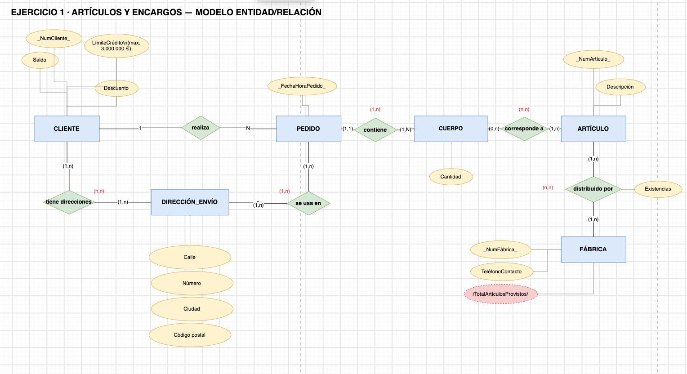
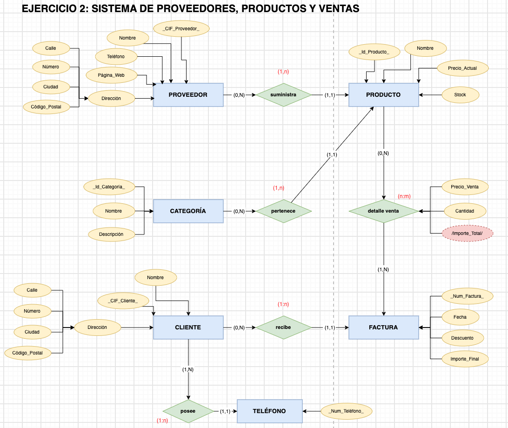
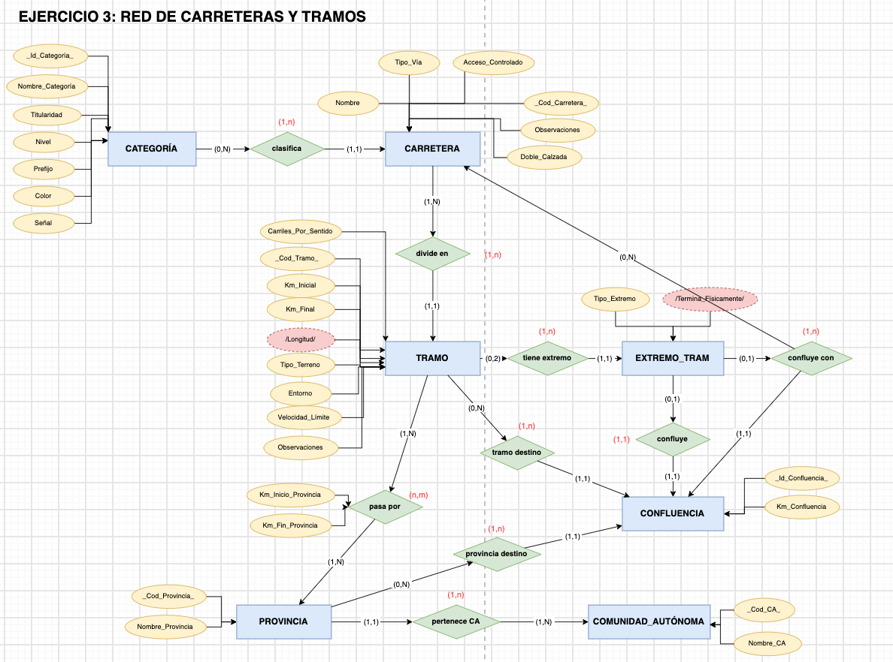
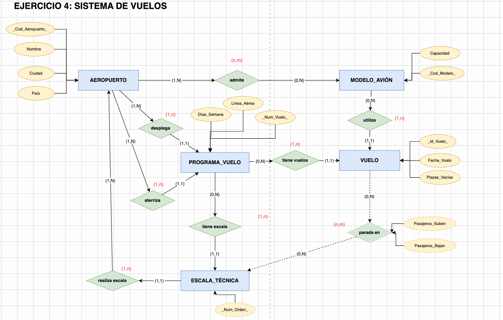
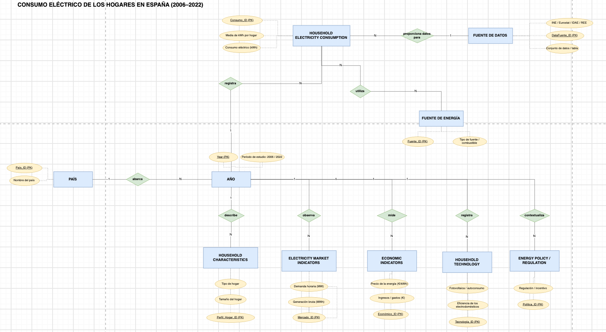
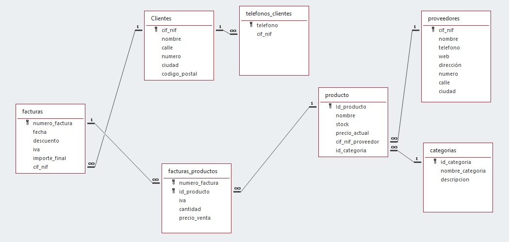
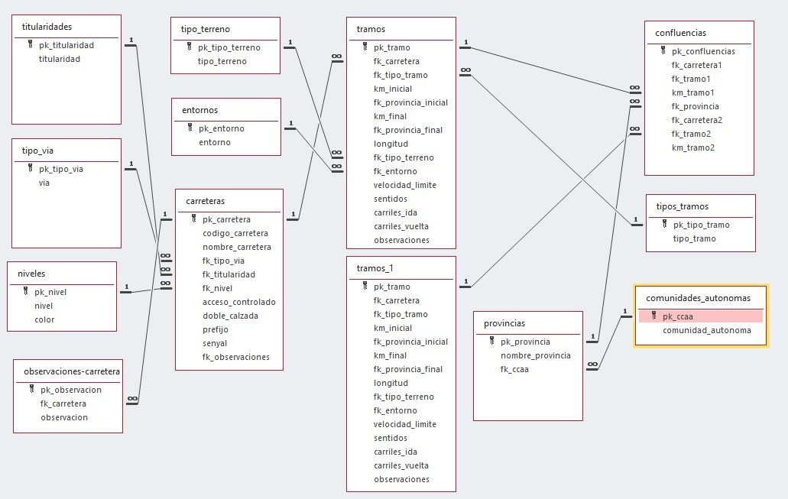

# MySQL — Ejercicios y diseño de bases de datos

Repositorio de ejercicios prácticos de **MySQL**, diseño de bases de datos y transformación de modelos entidad-relación a modelo relacional.

## 1. Ciclo de vida de los datos

 [**Ver ejercicios del ciclo de vida de los datos**](Ciclo_de_vida_datos.md)

## 2. Diseño de bases de datos

Ejercicios de diseño y modelado de bases de datos.

<table>
  <tr>
    <td align="center" width="50%">
      <strong>Diseño 1</strong>  
      
    </td>
    <td align="center" width="50%">
      <strong>Diseño 2</strong>  
      
    </td>
  </tr>
  <tr>
    <td align="center" width="50%">
      <strong>Diseño 3</strong>  
      
    </td>
    <td align="center" width="50%">
      <strong>Diseño 4</strong>  
      
    </td>
  </tr>
</table>

##  3. Modelo entidad-relación → modelo relacional

Ejercicios de transformación de diagramas entidad-relación en modelos relacionales, identificando entidades, atributos, claves y relaciones.

 [**Ver ejercicios de entidad-relación a modelo relacional**](Entidad-Relacion.md)

## 4. Proyecto final

Desarrollo del proyecto final de diseño y modelado de entidades.

  

## 5. Ejercicios en Microsoft Access

### Ejercicio 2

  

### Ejercicio 3

  

## Herramientas

- **MySQL:** consultas y gestión de bases de datos.
- **Modelado de datos:** diagramas entidad-relación y modelo relacional.
- **Microsoft Access:** diseño y ejercicios prácticos de bases de datos.

  <i>Repositorio de aprendizaje y práctica de bases de datos.</i>

