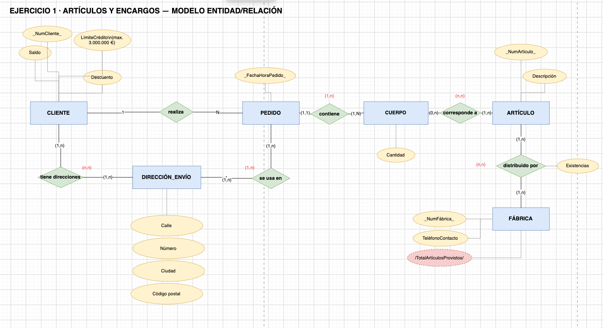
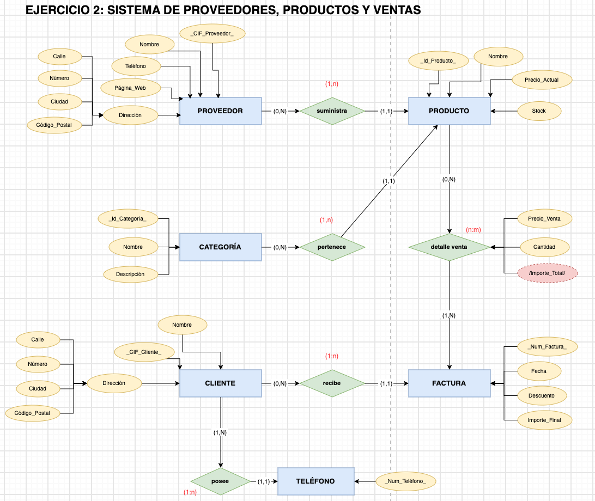
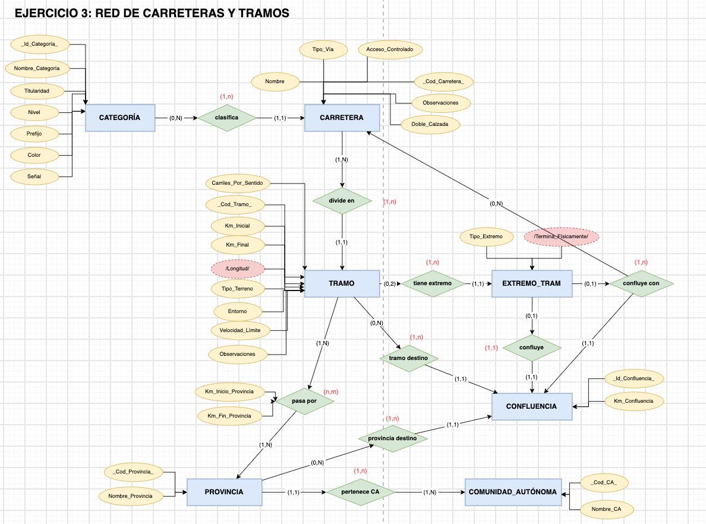
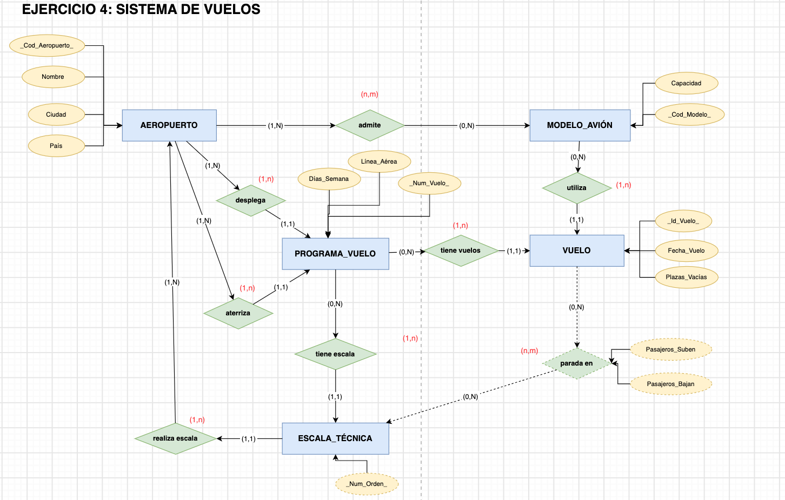
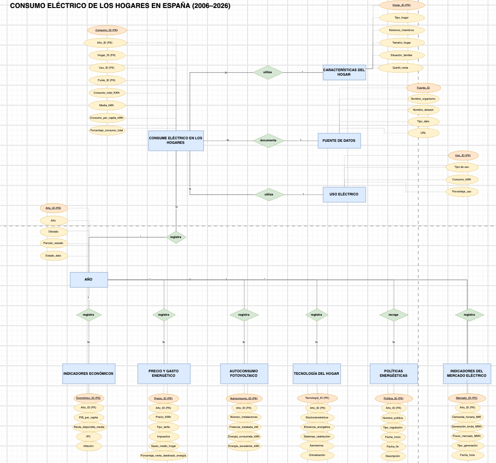
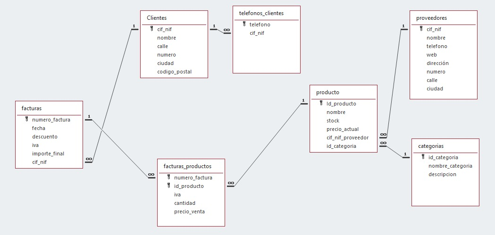
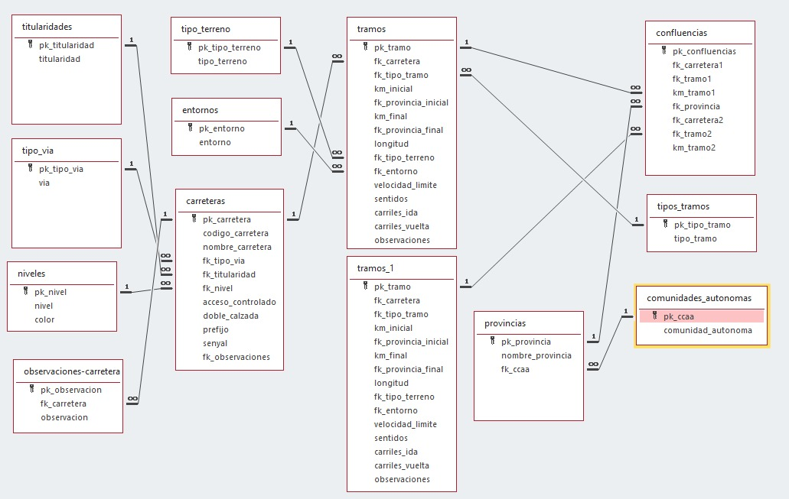
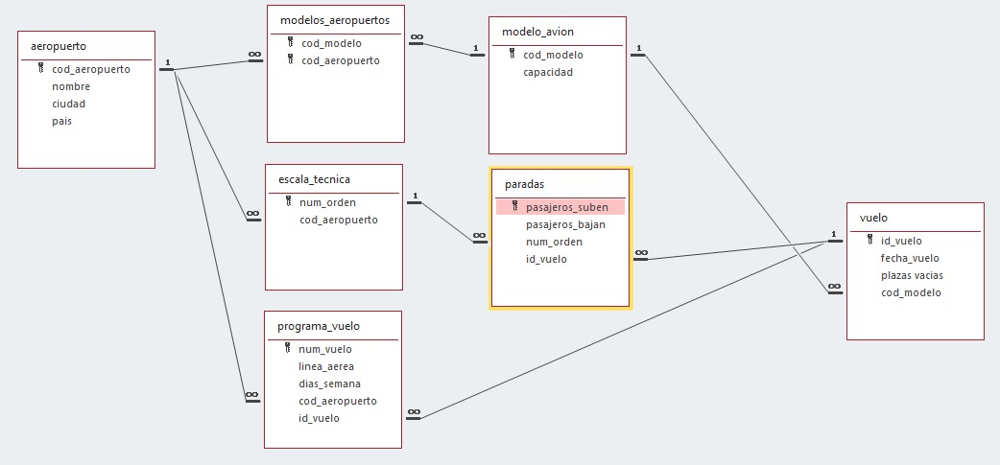

# MySQL — Ejercicios y diseño de bases de datos

Repositorio de ejercicios prácticos de **MySQL**, diseño de bases de datos y transformación de modelos entidad-relación a modelo relacional.

## 1. Ciclo de vida de los datos

[**Ver ejercicios del ciclo de vida de los datos**](Ciclo_de_vida_datos.md)

## 2. Diseño de bases de datos

Ejercicios de diseño y modelado de bases de datos.

<table>
  <tr>
    <td align="center" width="50%">
      <strong>Diseño 1</strong>  
      
    </td>
    <td align="center" width="50%">
      <strong>Diseño 2</strong>  
      
    </td>
  </tr>
  <tr>
    <td align="center" width="50%">
      <strong>Diseño 3</strong>  
      
    </td>
    <td align="center" width="50%">
      <strong>Diseño 4</strong>  
      
    </td>
  </tr>
</table>

## 3. Modelo entidad-relación → modelo relacional

Ejercicios de transformación de diagramas entidad-relación en modelos relacionales, identificando entidades, atributos, claves y relaciones.

[**Ver ejercicios de entidad-relación a modelo relacional**](Entidad-Relacion.md)

## 4. Proyecto final

Desarrollo del proyecto final de diseño y modelado de entidades.

  

### Introducción y Justificación del Proyecto
* **Contexto:** El proyecto consiste en el diseño, modelado e implementación de una base de datos relacional orientada a centralizar, estructurar y analizar la evolución del consumo eléctrico en los hogares españoles durante el periodo de transición energética comprendido entre 2006 y 2026.
* **Justificación:** El análisis del metabolismo energético residencial requiere cruzar múltiples variables heterogéneas (sociales, económicas, tecnológicas y políticas) que habitualmente se encuentran dispersas en diferentes organismos oficiales (INE, Eurostat, IDAE, REE). Esta base de datos unifica toda esa información en un único modelo normalizado y coherente para permitir consultas analíticas complejas.

### Objetivos del Proyecto
* **Objetivo General:** Desarrollar una infraestructura de datos robusta que almacene y relacione de forma eficiente el consumo eléctrico de los hogares en España con los factores socioeconómicos, tecnológicos y normativos que lo condicionan.
* **Objetivos Específicos:**
  * Almacenar las series temporales de producción y consumo eléctrico bruto y residencial entre 2006 y 2026.
  * Relacionar el consumo eléctrico con variables demográficas y sociales (tamaño del hogar, tipologías familiares y evolución de hogares unipersonales).
  * Integrar indicadores económicos clave (renta por quintiles, evolución del precio del kWh corregido por inflación y gasto en energía).
  * Gestionar el impacto de factores tecnológicos (penetración del autoconsumo fotovoltaico, aerotermia y eficiencia de electrodomésticos).
  * Registrar el marco regulatorio e institucional (normativa de eficiencia en edificios, ayudas del IDAE y el impacto histórico de políticas fiscales como el "impuesto al sol").

### Alcance y Delimitación (Scope)
* **Ámbito Geográfico:** España (con enfoque principal en el sistema eléctrico peninsular y nacional según disponibilidad de registros).
* **Ámbito Temporal:** Serie histórica de 2006 a 2026 (con extensiones puntuales hasta 2023 para métricas recientes de autoconsumo fotovoltaico).
* **Población de Estudio:** Exclusivamente el sector residencial (hogares), excluyendo de manera deliberada los sectores industriales y de transporte, tal como delimita el estudio original.

### Fuentes de Datos de Origen
Para poblar y alimentar el sistema de bases de datos, se utilizarán los conjuntos de datos públicos extraídos de las referencias del TFG:
* **INE (Instituto Nacional de Estadística):** Encuesta de Presupuestos Familiares (EPF), gasto medio por hogar y distribución del tamaño/tipo de hogares.
* **Eurostat:** Balances energéticos y consumo final por usos del sector residencial.
* **IDAE (Instituto para la Diversificación y Ahorro de la Energía):** Informes de consumos en usos residenciales y datos de eficiencia.
* **REE (Red Eléctrica de España) / OMIE:** Curvas de demanda horaria y estructura de generación eléctrica.
* **APPA / Statista:** Estadísticas de potencia instalada y número de instalaciones de autoconsumo fotovoltaico.

### Casos de Uso y Consultas Analíticas (SQL / Business Intelligence)
El planteamiento del proyecto se validará demostrando que la base de datos puede responder a preguntas complejas de investigación como:
1. ¿Cómo ha evolucionado el consumo per cápita en los hogares unipersonales en comparación con los hogares de 4 o más miembros entre 2006 y 2022?
2. ¿Qué impacto cuantitativo tuvo la vigencia del "impuesto al sol" (2015-2018) en el freno de las instalaciones fotovoltaicas residenciales frente al boom posterior a su derogación?
3. ¿De qué manera incide el nivel de renta (quintiles de gasto) en la capacidad de los hogares para acometer inversiones en eficiencia energética o autoconsumo?

## 5. Ejercicios en Microsoft Access

### Ejercicio 2

  

### Ejercicio 3

  

### Ejercicio 4

  

